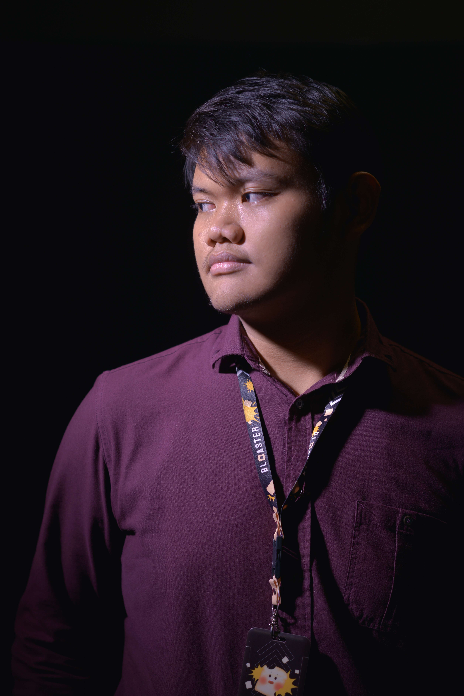

# Personal Portfolio Website — Technical & Design Report

**Project:** `Bakorz/Homework` — personal portfolio page for Muhammad Bagaskoro
**Artifact:** single file `index.html` (HTML + internal CSS, no JavaScript)
**Branch:** `feat/css-techniques-per-assignment` (commits `5407346`, `7aac92c`, `eec6387`)
**Report scope:** design concept, interface display, user guide, assignment requirement coverage, and complete source code

> **Version note.** Two builds exist in this repository.
> **v1 — `rebuild/600-loc-single-file`:** a deliberately minimal 598-line rebuild (single file, internal CSS, no CSS variables, one breakpoint).
> **v2 — `feat/css-techniques-per-assignment` (this report):** the same page plus every CSS technique the assignment requires (box-shadow, float/clearfix, fixed + absolute positioning, combinators, `:hover`/`:focus`, 2D transforms, transitions, `@keyframes`) — **738 lines**.
> v2 is the version intended for submission; Appendix A lists its complete source code.

---

## 1. Project Overview

The page is a one-page personal portfolio ("get in touch" page) for a backend engineer. Students were free to choose a topic; a personal profile page was selected. The build started from a hard self-imposed constraint and then had to satisfy the assignment's explicit CSS requirement list.

| Constraint | Requirement | Delivered |
| --- | --- | --- |
| Total size (self-imposed, v1) | ≤ 600 lines of code, HTML + CSS combined | v1: **598** ✓ · v2: **738** — cap intentionally relaxed (see §2.9) |
| Formatting | Code must stay Prettier-formatted | `npx prettier@3.3.3 --check index.html` **passes** |
| CSS variables | No `var()`, no custom properties | **0** occurrences |
| CSS delivery | Internal stylesheet only (assignment item 9) | one `<style>` block; no external stylesheet |
| Assignment items 1–9 | box-shadow, float/clearfix, fixed/absolute/sticky, combinators, `:hover`/`:focus`, 2D transforms, transitions, `@keyframes`, internal CSS | **all present** — see §6 |

Measured facts about the delivered artifact:

- **738 lines** (`wc -l`), 19,759 bytes: **CSS 477 lines** (82 rules inside `<style>`) + **HTML 261 lines**.
- **Zero external dependencies**: no external CSS, no web fonts, no JavaScript, no CDN requests.
- The only binary asset is the local hero photograph `img/PEN_4350.jpg`.
- No build step: the file opens directly in a browser, and also runs over any static HTTP server.

---

## 2. Design Concept

### 2.1 Concept statement

> A calm, dark "engineer's terminal-meets-editorial" portfolio: a wide dark canvas, one accent colour for interactive intent, monospace accents for technical voice, a strict card-based rhythm, and motion used only to confirm interaction.

The page targets a recruiter or collaborator scanning for 30 seconds, so identity is front-loaded (name, role, one-line pitch, direct links) and evidence follows in a fixed order: experience → skills → education → contact.

### 2.2 Colour system

The palette is **Catppuccin Mocha**, reduced to 13 values. Because custom properties are forbidden by the brief, colours are literal hex values inside each rule; this table is the single source of truth for the palette.

| Hex | Role in the page |
| --- | --- |
| `#1e1e2e` | Page background (base) |
| `#181825` | Card / panel / form surfaces |
| `#11111b` | Footer bar (crust), submit-button label |
| `#313244` | Borders, hero photo frame, table row rules, back-to-top fill |
| `#45475a` | Input borders, button borders, chip borders and hover fill |
| `#cdd6f4` | Primary text |
| `#a6adc8` | Secondary text (lede, bullets, form labels) |
| `#9399b2` | Muted text (metadata, footer note) |
| `#cba6f7` | Primary accent: role line, section eyebrows, accent rule, badge, submit button |
| `#b4befe` | Secondary accent: brand suffix, chips, bullet markers, nav CTA, hover borders |
| `#74c7ec` | Tertiary accent: highlighted "email" action button |
| `#f9e2af` | Floated year tag in the organisational cards |
| `#89b4fa` | Keyboard focus ring |

Colour decisions were contrast-driven: an earlier, darker muted tone measured only **4.44:1** against the card surface and was replaced by `#9399b2`.

### 2.3 Typography

- **Body:** system font stack — `system-ui, -apple-system, "Segoe UI", Roboto, sans-serif`; base 16 px; line-height 1.6. Removing the web-font download keeps the page fast and usable on restricted networks.
- **Mono accent:** `ui-monospace, SFMono-Regular, Menlo, Consolas, monospace` via the `.mono` class on the role line, section eyebrows, the brand, and contact links — a "technical voice" with no extra download.
- **Type scale:** `0.75 / 0.78 / 0.82 / 0.83 / 0.85 / 0.9 / 0.92 / 0.93 / 0.95 / 1.05 / 1.1 / 1.12 / 1.15 / 1.7 / 2.6 rem`, with `h1` dropping to `2rem` on phones.
- **Display weights and tracking:** `h1` 800 / `2.6rem` / `-0.03em`; `h2` 800 / `1.7rem` / `-0.02em`; `h3` 700 / `1.12rem`. Tight tracking on large headings is what makes the typography feel deliberate.

### 2.4 Layout and spacing system

- **Content container:** `main` is `max-width: 1040px; margin: 0 auto; padding: 0 20px` and — per assignment item 2 — an explicit **CSS Grid container** (`display: grid; grid-template-columns: minmax(0, 1fr)`). The `minmax(0, 1fr)` form is deliberate: the default `auto` track cannot shrink below its items' min-content size, which produced a 304 px overflow on 320 px screens until it was fixed.
- **Section grids:** the hero (`1.4fr 1fr`), the contact block (`1fr 1fr`) and the form row (`1fr 1fr`) are grids too; all three collapse to one column at ≤ 640 px.
- **Flexbox (component level):** navigation bar, cards, bullet lists, chip rows, contact list, button rows and the footer bar.
- **Vertical rhythm:** sections use `padding-top: 56px` with `gap: 24px`; the hero uses `64px 0 40px`; the footer is separated by `margin-top: 64px`. Spacing steps: **6 / 8 / 12 / 14 / 16 / 18 / 20 / 24 / 40 / 56 / 64 px**.
- **Radii:** `6px` (chips, float tag) · `10px` (buttons, inputs) · `16px` (cards, table panel, form) · `24px` (hero photo) · `999px` (badge, back-to-top).
- **Depth:** surfaces, 1 px borders and — since assignment item 1 — soft `box-shadow` layers (`0 10px 24px rgba(0,0,0,0.22)` on cards and the form; stronger on hover).

### 2.5 Component vocabulary

The 82 CSS rules resolve to a small set of reusable components:

1. **Reset (7 rules)** — `border-box` everywhere, margin reset, list/table resets, image block display, inherited link and control colours, global `:focus-visible` ring.
2. **Navigation** — `.nav` (sticky, `z-index: 10`) / `.nav-in` / `.brand` / `.nav-links` / `.nav-cta`.
3. **Hero** — `.hero` grid, `.hero-copy`, `h1`, `.role`, `.lede`, `.links`, `.btn`, `.btn--accent`, `.photo-wrap` + `.photo` + `.badge`.
4. **Section shell** — `.block`, `.eyebrow` (uppercase mono label with a `::before` accent rule), `h2`.
5. **Cards** — `.card` (experience, organisations, education) with `h3`, `.sub` metadata and a `:hover` lift.
6. **Lists** — `.bullets` with a CSS-drawn `▹` marker.
7. **Chips** — `.chips` / `.chip` technology pills.
8. **Data table** — `.table-wrap` panel containing a real `<table>` (skills matrix).
9. **Float + clearfix block** — `.float-tag` (floated year) inside `.clearfix`, demonstrating text wrapping around a float.
10. **Contact block** — `.contact-grid` and `.contact-list`.
11. **Form** — `.form`, `.form-row`, `.form label`, `.input`, submit `button`.
12. **Fixed utility control** — `.to-top` back-to-top button (`position: fixed`, `z-index: 20`).
13. **Footer** — `footer` / `.footer-in`.
14. **Motion layer** — transitions, hover transforms and the `fade-up` keyframe animation.

### 2.6 Responsive strategy

A single breakpoint, `@media (max-width: 640px)`, keeps the stylesheet compact while covering the layout that actually breaks:

| At ≤ 640 px | Change |
| --- | --- |
| `.hero`, `.contact-grid`, `.form-row` | two-column grids collapse to one column |
| `.photo-wrap` | moves above the text (`order: -1`) and shrinks to `min(200px, 70%)` |
| `.nav-in` | wraps instead of a fixed 64 px row |
| `.nav-links` | smaller type, tighter gap, no auto margin |
| `h1`, `.hero`, `.block` | `2rem` heading, reduced top padding |
| `.card`, `.form` | padding `24px → 18px` |
| `th`, `td` | padding `16px → 12px` |

Independent guards prevent horizontal scrolling at any width: `.nav-links` and `.links` use `flex-wrap: wrap`, the skills table sits in an `overflow-x: auto` panel, and the main grid track uses `minmax(0, 1fr)`. Verified at 320, 360, 375, 414, 640, 768, 1024, 1280 and 1600 px — no horizontal overflow at any width.

### 2.7 Accessibility by design

- `lang="en"`, `<title>`, meta description and viewport meta are present; heading outline is 1 × `h1`, 4 × `h2`, 5 × `h3`.
- The skills matrix is a real `<table>` with `aria-label`, 2 × `scope="col"` and 4 × `scope="row"`.
- Form controls use **implicit labels** (`<label>Full Name <input …></label>`), so every control has an accessible name; three fields are `required` and the email field uses `type="email"`.
- A global `:focus-visible { outline: 2px solid #89b4fa; outline-offset: 2px }` guarantees visible keyboard focus; `:focus` also highlights the border of the active input.
- The back-to-top control is a real link with `aria-label="Back to top"`, and `html { scroll-padding-top: 72px }` keeps anchor targets clear of the sticky header.
- **Motion safety:** all decorative motion is disabled under `@media (prefers-reduced-motion: reduce)`.

### 2.8 Motion and interaction language

Motion exists to confirm interaction, never to decorate for its own sake:

- **Hover:** cards lift (`translateY(-3px)`) and gain a deeper shadow; buttons lift `2px` and switch to a lavender border; navigation links and chips shift colour; the corner badge rotates and scales slightly; the back-to-top button rises and grows (`translate(0, -3px) scale(1.06)`).
- **Transitions:** `0.2s ease` on transform, box-shadow, background-color, border-color and colour — short enough to feel immediate.
- **Entry animation:** the hero portrait fades and rises once (`@keyframes fade-up`, 700 ms, 100 ms delay, `cubic-bezier(0.2, 0.7, 0.3, 1)`, `fill-mode: both`).
- **Drawn, not loaded:** the bullet marker (`▹`), the eyebrow accent rule, the flexible chip and card shapes, and the back-to-top glyph are CSS or single characters — no icon files.

### 2.9 Trade-offs and the line budget

Prettier formats one declaration per line, so stylesheet length tracks the *number of declarations* (≈ 2–3 lines of overhead per rule).

- **v1 (598 lines)** was achieved by removing decoration: no shadows, no hover, no transforms, no transitions, no animations, no float block, no fixed/absolute positioning, no extra combinators. It satisfies the self-imposed cap but **fails eight of the assignment's nine requirement items**.
- **v2 (738 lines)** restores every required technique. The growth (+140 lines) is the cost of assignment compliance, not of decoration: it buys box-shadow, float + clearfix, three extra positioning modes, two combinator families, interactive pseudo-classes, decorative `::before`, 2D transforms, transitions and a keyframe animation.
- **Kept from v1:** the full written content, the Catppuccin palette, system fonts (no downloads), internal CSS only, semantic landmarks, labels, alt text, AA contrast, and the JS-free, dependency-free build.

---

## 3. Interface Display

### 3.1 Page composition (desktop)

1. **Sticky header** — wordmark `Bagaskoro.dev` (the `.dev` suffix in lavender), then Home, Experience, Skills, Education, and a bordered **Get In Touch** call-to-action.
2. **Hero (`#top`)** — two columns. Left: `Muhammad Bagaskoro` (`h1`), the line `$ Software Engineer` in mauve monospace, the summary paragraph, a location/phone line, and two action buttons (GitHub, highlighted email). Right: the square-cropped portrait inside a framed wrapper with an **"Open to work" corner badge** rotated −4°, animating in on load.
3. **Experience (`#experience`)** — eyebrow `CAREER HISTORY`, heading "Work & Leadership Experience", one card with the Backend Engineer role (PDBL Team Project), five `▹` bullets and seven technology chips; then "Organizational Experience" with two cards whose year tag is **floated right so the description wraps around it**.
4. **Skills (`#skills`)** — eyebrow `COMPETENCIES` and a bordered panel holding a four-row, two-column matrix (Back-End Development · Automation & AI · Database & Distributed Systems · Development Tools).
5. **Education (`#education`)** — eyebrow `ACADEMIC BACKGROUND`, one card: Politeknik Elektronika Negeri Surabaya (PENS), the degree and a specialisation note.
6. **Contact (`#contact`)** — eyebrow `GET IN TOUCH`. Left: "Start a Collaboration" plus four direct channels (email, LinkedIn, GitHub, phone). Right: the contact form panel.
7. **Footer** — dark crust bar with the note "Designed with Love".
8. **Fixed control** — a circular back-to-top button appears at the bottom-right and stays there while scrolling.

### 3.2 Interaction inventory

| Trigger | Effect (measured in the browser) |
| --- | --- |
| Hover a card | `transform: matrix(1,0,0,1,0,-3)` (3 px lift) + shadow deepens |
| Hover the submit button | 2 px lift, border turns lavender |
| Hover the back-to-top button | `scale(1.06)` + 3 px rise, background lightens |
| Hover the corner badge | rotates to +3° and scales to 1.06 |
| Hover a navigation link | colour transition (`0.2s`) |
| Focus any control (keyboard) | 2 px sapphire outline, offset 2 px |
| Focus an input | border colour changes to `#89b4fa` |
| Page load | portrait runs the `fade-up` animation (700 ms, 100 ms delay, fill `both`) |
| Click a header link | jumps to the section; `scroll-padding-top` keeps the heading below the sticky bar |
| Click the back-to-top button | returns to `#top` |
| Hover the floated year tag | (static by design — it is content, not a control) |

### 3.3 Mobile presentation (≤ 640 px)

The header wraps onto two rows; the portrait moves above the name (with the badge still attached to the photo's corner); every two-column block becomes a single column; paddings tighten; the back-to-top button overlays the bottom-right corner without covering content. No horizontal scrolling at 320 px and above.

---

## 4. User Guide

### 4.1 Opening the page

- **Simplest:** double-click `index.html` — it opens in any modern browser. There is no build step and no dependency to install.
- **Via a local server:**

  ```bash
  cd Homework
  python3 -m http.server 8000 --bind 127.0.0.1
  # then open http://127.0.0.1:8000/index.html
  ```

### 4.2 Navigating the page

1. Use the sticky header links — **Home → Experience → Skills → Education → Get In Touch** — to jump straight to a section (no smooth-scroll animation; the browser default is used). Each target lands *below* the header, never hidden behind it, thanks to `scroll-padding-top: 72px`.
2. At any point while scrolling, press the circular **↑ back-to-top button** (bottom-right, fixed) to return to the hero.
3. Press `Tab` to move focus through links and form fields; the blue outline shows exactly where you are. `Shift+Tab` moves backwards. Hovering a card or button shows a small lift as feedback.
4. On a phone, the header links wrap onto a second row, so all five destinations stay reachable without zooming.

### 4.3 Reading path for a first-time visitor

- **0–5 s:** name, role, one-line pitch, and two direct actions (GitHub / email) in the hero.
- **5–30 s:** the experience card answers "what has he built?" — invoice automation with .NET, FastAPI, PaddleOCR and Ollama, plus queueing and caching.
- **30–60 s:** the skills matrix maps domains to technologies; education closes the credibility gap.
- **Then:** the contact section converts interest into action.

### 4.4 Using the contact form

| Field | Type | Required | Notes |
| --- | --- | --- | --- |
| Full Name | text | yes | |
| Email Address | email | yes | browser validates the address format |
| Phone / WhatsApp | tel | no | optional |
| Message / Project Details | textarea (4 rows) | yes | project goals, timelines, questions |

- **Submitting** uses `action="mailto:bagaskoro.moe@gmail.com" method="post" enctype="text/plain"`, so the browser composes an email containing your input and hands it to the default mail client. Review it there, then send.
- **If nothing happens on submit**, no mail client is configured — use the direct channels listed beside the form instead (email, LinkedIn, GitHub, phone).
- **No data reaches or is stored on any server by this page:** it is static, with no backend and no JavaScript — no tracking, no cookies, no database.

### 4.5 Accessibility guide

- **Keyboard-only:** every link and control is reachable with `Tab`; the 2 px blue focus outline is always visible.
- **Screen reader:** one `h1` names the page, `h2` separates the four subject areas, the skills matrix announces row and column headers, the portrait carries the alternative text "Muhammad Bagaskoro", the back-to-top link is announced as "Back to top", and each form control is announced with its label and required state.
- **Low vision:** text colours were verified against their real backgrounds at AA contrast (76 text elements measured, 0 failures) and the layout reflows to a single column, so text can be enlarged without horizontal scrolling.
- **Motion sensitivity:** with `prefers-reduced-motion: reduce` the fade-in and hover transforms are switched off.

### 4.6 Customising the page

| Goal | How |
| --- | --- |
| Change the palette | Replace the hex values in §2.2 (no `var()`, so use find-and-replace, e.g. `#cba6f7`) |
| Change the portrait | Replace `img/PEN_4350.jpg`; the frame crops it to a square |
| Change the corner badge | Edit the text inside `<span class="badge">` |
| Slow down / remove the entry animation | Edit `animation-duration` / `animation-delay` on `.photo-wrap img` |
| Move the back-to-top button | Change `right` / `bottom` in `.to-top` |
| Edit content | All copy is plain HTML inside the matching `<section>`; keep heading levels consistent |
| Re-check the budget | `wc -l index.html` |
| Re-apply formatting | `npx prettier@3.3.3 --write index.html` |

### 4.7 Verifying your edits

Minimum checks after any change:

```bash
wc -l index.html                                   # size
npx prettier@3.3.3 --check index.html              # formatting must stay clean
python3 -m http.server 8000 --bind 127.0.0.1       # then: no horizontal scrollbar at 320 / 768 / 1280 px
```

---

## 5. Quality Evidence (measured)

| Check | Result |
| --- | --- |
| Total lines (`wc -l`) | **738** — CSS 477 (82 rules) + HTML 261 |
| File size | 19,759 bytes |
| Prettier compliance | `npx prettier@3.3.3 --check index.html` → *All matched files use Prettier code style* (default config; no `.prettierrc` on this branch) |
| `var()` / external stylesheet | 0 / 0 |
| Horizontal overflow | **none** at 320, 360, 375, 414, 640, 768, 1024, 1280, 1600 px |
| Contrast (AA) | 76 text elements checked, **0 failures** |
| Colour tokens / dead classes | 13 unique hex values · 33 classes used = 33 defined (0 dead) |
| CSS structure | braces balanced (82 / 82) |
| Hover behaviour | card `matrix(1,0,0,1,0,-3)`; back-to-top `matrix(1.06,0,0,1.06,0,-3)`; badge rotation matrix present |
| Animation | `getAnimations()` → name `fade-up`, duration 700 ms, delay 100 ms, fill `both`, timing `cubic-bezier(0.2, 0.7, 0.3, 1)` |
| Float proof | floated tag's right edge equals the paragraph's right edge (1108 px = 1108 px) |
| `::before` on section titles | computed content `""`, 22 × 2 px, `rgb(203, 166, 247)` |
| Form accessibility | 4 controls + submit; 4 implicit labels; 3 required fields |
| Table semantics | `aria-label` + 2 × `scope="col"` + 4 × `scope="row"` |
| Anchors | header link leaves the target heading at 154 px with the header ending at 65 px — not obscured |
| Hero image | `img/PEN_4350.jpg` (4912 × 7360 source) rendered at 300 × 320, square-cropped |

---

## 6. Assignment Requirement Coverage

| # | Requirement | Where it lives (evidence) |
| --- | --- | --- |
| 1 | Box model (margin, padding, border), `border-radius`, `box-shadow`, `word-wrap` | 5 margin / 22 padding / 25 border / 12 `border-radius` / 6 `box-shadow` declarations; `body { word-wrap: break-word }` inherits everywhere |
| 2 | At least two layout methods: Grid for content, Flexbox for components, plus a float + clearfix section | `main { display: grid; grid-template-columns: minmax(0, 1fr) }` + hero/contact/form grids; 12 Flexbox rules; `.float-tag { float: right }` with `.clearfix::after { clear: both }` in the organisational cards |
| 3 | `position: sticky` nav, `position: fixed` back-to-top, `position: absolute` corner badge, `z-index` stacking | `.nav` (sticky, `z-index: 10`), `.to-top` (fixed, `z-index: 20`), `.badge` (absolute, `z-index: 2`) inside `.photo-wrap` (relative) |
| 4 | Child `>`, adjacent `+`, and descendant combinators | `.card > div > h3 + .sub { margin-top: 4px }` (computed 4 px) + 10 descendant selectors (e.g. `.nav-links a`, `.bullets li::before`) |
| 5 | Interactive `:hover` / `:focus`, `::before` decorative content on section titles | 11 `:hover` rules, 2 `:focus`-family rules, `.eyebrow::before` accent rule (plus `.bullets li::before`) |
| 6 | 2D transforms: `translate()`, `scale()`, `rotate()` on hover | `.to-top:hover { transform: translate(0, -3px) scale(1.06) }`; `.card:hover { transform: translateY(-3px) }`; `.badge:hover { transform: rotate(3deg) scale(1.06) }` |
| 7 | `transition` with duration and timing function | 6 transition declarations (`0.2s ease`) on buttons, cards, badge and nav links |
| 8 | `@keyframes` animation with `animation-name`, `-duration`, `-timing-function`, `-delay`, `-fill-mode` | `@keyframes fade-up` on `.photo-wrap img` with all five longhand properties (verified via `getAnimations()`) |
| 9 | Internal stylesheet, unified visual style, reasonable colour matching | single `<style>` block, no external CSS; one Catppuccin Mocha palette (§2.2) reused across every component |

---

## 7. Known Limitations and Suggested Next Steps

1. **Hero image weight** — the source photograph is ~1.26 MB and 4912 px wide while it renders at ~300 px. Resizing it to ~640 px would cut page weight far more than any CSS change. *(Highest-value optimisation.)*
2. **Form is mailto-only** — no backend; acceptable for coursework, not for production.
3. **Line count above the earlier self-imposed cap** — v2 is 738 lines versus the 598-line experiment; the difference is required techniques, not decoration (§2.9).
4. **Single breakpoint** — tablets (641–1023 px) receive the desktop layout; a second breakpoint would refine it (+15–20 lines).
5. **Not included:** no JavaScript, no favicon, no Open Graph/Twitter preview metadata, no light theme, no skip link, no `@media print` block (the web page itself need not print; the report does).
6. **Content still contains masked phone numbers** (`+628****7890`) — confirm this is intended before sharing the page publicly.
7. **Formatting config** — this branch runs Prettier defaults (printWidth 80); the only long line is the meta-description attribute. A wider `printWidth` would trim lines but can shift whitespace inside inline content, so it was left out of this verified build.

---

## 8. Repository Layout and Commands

```
Homework/
├── index.html        # 738 LOC — markup + internal CSS (the whole site)
├── img/PEN_4350.jpg  # hero portrait (only asset)
├── REPORT.md         # this document (design, interface, guide, coverage, source)
└── (no .prettierrc, no package.json on this branch)

branches:  rebuild/600-loc-single-file          # v1 — minimal, 598 lines
           feat/css-techniques-per-assignment   # v2 — assignment-complete, 738 lines  ← this report
```

```bash
wc -l index.html                                   # size check
npx prettier@3.3.3 --check index.html              # formatting gate
python3 -m http.server 8000 --bind 127.0.0.1       # local preview
```

---

## 9. Glossary

- **Box model** — the content / padding / border / margin layers every element is built from.
- **Clearfix** — the `::after { clear: both }` pattern that makes a container enclose its floated children.
- **Catppuccin Mocha** — the community dark colour scheme supplying every colour here.
- **Combinators** — `>` (child), `+` (adjacent sibling) and the descendant space, used to target elements precisely.
- **Float** — `float: right/left`; text wraps around floated boxes until cleared.
- **Implicit label** — a `<label>` that wraps its control, giving it an accessible name without `for`/`id`.
- **LOC** — lines of code, counted here with `wc -l`.
- **Prettier** — opinionated formatter; it writes one declaration per line, which is why stylesheet length tracks the number of declarations.
- **`prefers-reduced-motion`** — media query that lets the page respect a user's motion-sensitivity setting.
- **`z-index`** — stacking order for positioned elements (nav 10, badge 2, back-to-top 20).
- **`:focus-visible`** — shows focus styling for keyboard users without outlining mouse clicks.
- **`object-fit: cover`** — crops an image to fill its box without distortion.

---

*Report prepared for the `Homework` portfolio submission (deadline: Wednesday evening, Oct. 14). All figures were measured from the committed artifact on branch `feat/css-techniques-per-assignment`.*

---

## Appendix A — Complete Source Code (`index.html`)

```html
<!doctype html>
<html lang="en">
  <head>
    <meta charset="utf-8" />
    <meta name="viewport" content="width=device-width, initial-scale=1" />
    <title>Muhammad Bagaskoro — Software Engineer</title>
    <meta
      name="description"
      content="Muhammad Bagaskoro — Software Engineer focused on backend development and process automation: .NET, FastAPI, PaddleOCR, Ollama."
    />
    <style>
      *,
      *::before,
      *::after {
        box-sizing: border-box;
      }
      body,
      h1,
      h2,
      h3,
      p,
      ul,
      dl,
      dd,
      dt {
        margin: 0;
      }
      ul {
        padding: 0;
        list-style: none;
      }
      img {
        display: block;
        max-width: 100%;
      }
      a {
        color: inherit;
        text-decoration: none;
      }
      input,
      textarea,
      button {
        font: inherit;
        color: inherit;
      }
      :focus-visible {
        outline: 2px solid #89b4fa;
        outline-offset: 2px;
      }
      html {
        scroll-padding-top: 72px;
      }
      body {
        word-wrap: break-word;
        background-color: #1e1e2e;
        color: #cdd6f4;
        font-family:
          system-ui,
          -apple-system,
          "Segoe UI",
          Roboto,
          sans-serif;
        line-height: 1.6;
      }
      main {
        display: grid;
        grid-template-columns: minmax(0, 1fr);
        max-width: 1040px;
        margin: 0 auto;
        padding: 0 20px;
      }
      .mono {
        font-family: ui-monospace, SFMono-Regular, Menlo, Consolas, monospace;
      }
      .sub {
        color: #9399b2;
        font-size: 0.9rem;
      }
      .nav {
        position: sticky;
        top: 0;
        z-index: 10;
        background-color: rgba(24, 24, 37, 0.96);
        border-bottom: 1px solid #313244;
      }
      .nav-in {
        max-width: 1040px;
        margin: 0 auto;
        padding: 0 20px;
        height: 64px;
        display: flex;
        align-items: center;
        gap: 24px;
      }
      .brand {
        font-size: 1.1rem;
        font-weight: 800;
      }
      .brand span {
        color: #b4befe;
      }
      .nav-links {
        display: flex;
        flex-wrap: wrap;
        align-items: center;
        gap: 18px;
        margin-left: auto;
        font-size: 0.92rem;
        color: #a6adc8;
      }
      .nav-cta {
        padding: 8px 14px;
        border: 1px solid rgba(180, 190, 254, 0.35);
        border-radius: 10px;
        color: #b4befe;
        font-weight: 600;
      }
      .hero {
        display: grid;
        grid-template-columns: 1.4fr 1fr;
        align-items: center;
        gap: 40px;
        padding: 64px 0 40px;
      }
      .hero-copy {
        display: flex;
        flex-direction: column;
        gap: 18px;
      }
      h1 {
        font-size: 2.6rem;
        font-weight: 800;
        letter-spacing: -0.03em;
      }
      .role {
        color: #cba6f7;
        font-size: 1.15rem;
        font-weight: 700;
      }
      .lede {
        color: #a6adc8;
        max-width: 54ch;
      }
      .links {
        display: flex;
        flex-wrap: wrap;
        gap: 12px;
      }
      .btn {
        transition:
          transform 0.2s ease,
          border-color 0.2s ease,
          background-color 0.2s ease;
        padding: 10px 16px;
        background-color: #313244;
        border: 1px solid #45475a;
        border-radius: 10px;
        font-size: 0.9rem;
      }
      .btn--accent {
        background-color: transparent;
        border-color: rgba(116, 199, 236, 0.4);
        color: #74c7ec;
      }
      .photo {
        width: 100%;
        aspect-ratio: 1 / 1;
        object-fit: cover;
        border: 8px solid #313244;
        border-radius: 24px;
      }
      .block {
        display: flex;
        flex-direction: column;
        gap: 24px;
        padding: 56px 0 0;
      }
      .eyebrow {
        color: #cba6f7;
        font-size: 0.78rem;
        font-weight: 700;
        letter-spacing: 0.08em;
      }
      h2 {
        margin-top: 6px;
        font-size: 1.7rem;
        font-weight: 800;
        letter-spacing: -0.02em;
      }
      .card {
        box-shadow: 0 10px 24px rgba(0, 0, 0, 0.22);
        padding: 24px;
        background-color: #181825;
        border: 1px solid #313244;
        border-radius: 16px;
        display: flex;
        flex-direction: column;
        gap: 16px;
      }
      h3 {
        font-size: 1.12rem;
        font-weight: 700;
      }
      .bullets {
        display: flex;
        flex-direction: column;
        gap: 8px;
        color: #a6adc8;
        font-size: 0.95rem;
      }
      .bullets li::before {
        content: "▹ ";
        color: #b4befe;
      }
      .chips {
        display: flex;
        flex-wrap: wrap;
        gap: 8px;
      }
      .chip {
        padding: 4px 12px;
        border: 1px solid #45475a;
        border-radius: 6px;
        color: #b4befe;
        font-size: 0.83rem;
      }
      .table-wrap {
        overflow-x: auto;
        background-color: #181825;
        border: 1px solid #313244;
        border-radius: 16px;
      }
      table {
        width: 100%;
        border-collapse: collapse;
        font-size: 0.92rem;
      }
      th,
      td {
        padding: 16px;
        text-align: left;
        vertical-align: top;
        border-bottom: 1px solid #313244;
      }
      tbody th {
        width: 34%;
      }
      tbody tr:last-child th,
      tbody tr:last-child td {
        border-bottom: 0;
      }
      .contact-grid {
        display: grid;
        grid-template-columns: 1fr 1fr;
        gap: 24px;
      }
      .contact-list {
        display: flex;
        flex-direction: column;
        gap: 14px;
        margin-top: 18px;
      }
      .form {
        box-shadow: 0 10px 24px rgba(0, 0, 0, 0.22);
        min-width: 0;
        display: flex;
        flex-direction: column;
        gap: 14px;
        padding: 24px;
        background-color: #181825;
        border: 1px solid #313244;
        border-radius: 16px;
      }
      .form-row {
        display: grid;
        grid-template-columns: 1fr 1fr;
        gap: 14px;
      }
      .form label {
        min-width: 0;
        display: flex;
        flex-direction: column;
        gap: 6px;
        color: #a6adc8;
        font-size: 0.82rem;
      }
      .input {
        width: 100%;
        min-width: 0;
        padding: 10px 12px;
        background-color: #1e1e2e;
        border: 1px solid #45475a;
        border-radius: 10px;
        color: #cdd6f4;
        font-size: 0.93rem;
      }
      button {
        transition:
          transform 0.2s ease,
          background-color 0.2s ease;
        padding: 12px;
        background-color: #cba6f7;
        border: 0;
        border-radius: 10px;
        color: #11111b;
        font-weight: 700;
        cursor: pointer;
      }
      footer {
        margin-top: 64px;
        background-color: #11111b;
        border-top: 1px solid #313244;
      }
      .footer-in {
        max-width: 1040px;
        margin: 0 auto;
        padding: 24px 20px;
        display: flex;
        flex-wrap: wrap;
        align-items: center;
        justify-content: space-between;
        gap: 12px;
      }
      /* --- Visual effects, positioning, interaction (assignment items 1-8) --- */
      .eyebrow::before {
        content: "";
        display: inline-block;
        width: 22px;
        height: 2px;
        margin-right: 8px;
        background-color: #cba6f7;
        vertical-align: middle;
      }
      .card > div > h3 + .sub {
        margin-top: 4px;
      }
      .card {
        transition:
          transform 0.2s ease,
          box-shadow 0.2s ease;
      }
      .card:hover {
        transform: translateY(-3px);
        box-shadow: 0 14px 30px rgba(0, 0, 0, 0.3);
      }
      .btn:hover,
      button:hover {
        border-color: #b4befe;
        transform: translateY(-2px);
      }
      .nav-links a {
        transition: color 0.2s ease;
      }
      .nav-links a:hover {
        color: #cdd6f4;
      }
      .input:focus {
        border-color: #89b4fa;
      }
      .photo-wrap {
        position: relative;
        justify-self: center;
        width: min(300px, 100%);
      }
      .photo-wrap img {
        animation-name: fade-up;
        animation-duration: 0.7s;
        animation-timing-function: cubic-bezier(0.2, 0.7, 0.3, 1);
        animation-delay: 0.1s;
        animation-fill-mode: both;
      }
      .badge {
        position: absolute;
        top: -12px;
        right: -12px;
        z-index: 2;
        padding: 6px 12px;
        background-color: #cba6f7;
        border-radius: 999px;
        box-shadow: 0 6px 16px rgba(0, 0, 0, 0.35);
        color: #11111b;
        font-size: 0.75rem;
        font-weight: 700;
        transform: rotate(-4deg);
        transition: transform 0.2s ease;
      }
      .badge:hover {
        transform: rotate(3deg) scale(1.06);
      }
      .to-top {
        position: fixed;
        right: 20px;
        bottom: 20px;
        z-index: 20;
        display: grid;
        width: 44px;
        height: 44px;
        place-items: center;
        background-color: #313244;
        border: 1px solid #45475a;
        border-radius: 50%;
        box-shadow: 0 8px 20px rgba(0, 0, 0, 0.45);
        color: #cdd6f4;
        font-size: 1.05rem;
        transition:
          transform 0.2s ease,
          background-color 0.2s ease;
      }
      .to-top:hover {
        background-color: #45475a;
        transform: translate(0, -3px) scale(1.06);
      }
      .float-tag {
        float: right;
        margin: 0 0 8px 12px;
        padding: 4px 10px;
        background-color: #313244;
        border-radius: 6px;
        color: #f9e2af;
        font-size: 0.78rem;
      }
      .clearfix::after {
        display: block;
        clear: both;
        content: "";
      }
      @keyframes fade-up {
        from {
          opacity: 0;
          transform: translateY(14px);
        }
        to {
          opacity: 1;
          transform: translateY(0);
        }
      }
      @media (prefers-reduced-motion: reduce) {
        .photo-wrap img {
          animation: none;
        }
        .badge:hover,
        .card:hover,
        .to-top:hover,
        .btn:hover,
        button:hover {
          transform: none;
        }
      }
      @media (max-width: 640px) {
        .hero,
        .contact-grid,
        .form-row {
          grid-template-columns: 1fr;
        }
        .photo-wrap {
          order: -1;
          width: min(200px, 70%);
        }
        .nav-in {
          height: auto;
          flex-wrap: wrap;
          padding: 10px 16px;
        }
        .nav-links {
          gap: 12px;
          margin-left: 0;
          font-size: 0.85rem;
        }
        .hero {
          padding-top: 32px;
        }
        h1 {
          font-size: 2rem;
        }
        .block {
          padding-top: 36px;
        }
        .card,
        .form {
          padding: 18px;
        }
        th,
        td {
          padding: 12px;
        }
      }
    </style>
  </head>
  <body>
    <header class="nav">
      <div class="nav-in">
        <a class="brand" href="#top">Bagaskoro<span>.dev</span></a>
        <nav class="nav-links" aria-label="Primary">
          <a href="#top">Home</a>
          <a href="#experience">Experience</a>
          <a href="#skills">Skills</a>
          <a href="#education">Education</a>
          <a class="nav-cta" href="#contact">Get In Touch</a>
        </nav>
      </div>
    </header>
    <main>
      <section class="hero" id="top">
        <div class="hero-copy">
          <h1>Muhammad Bagaskoro</h1>
          <p class="role mono"><span>$</span> Software Engineer</p>
          <p class="lede">
            Efficient and results-driven Software Engineer focused on backend
            development and process automation, experienced with .NET, FastAPI,
            PaddleOCR, and Ollama.
          </p>
          <p class="sub">Palembang, Indonesia &middot; +628****7890</p>
          <div class="links">
            <a class="btn" href="https://github.com/Bakorz">GitHub</a>
            <a class="btn btn--accent" href="mailto:bagaskoro.moe@gmail.com"
              >bagaskoro.moe@gmail.com</a
            >
          </div>
        </div>
        <div class="photo-wrap">
          
          <span class="badge">Open to work</span>
        </div>
      </section>
      <section class="block" id="experience">
        <div>
          <p class="eyebrow mono">CAREER HISTORY</p>
          <h2>Work &amp; Leadership Experience</h2>
        </div>
        <article class="card">
          <div>
            <h3>Backend Engineer</h3>
            <p class="sub">PDBL Team Project</p>
          </div>
          <ul class="bullets">
            <li>
              Architecting an automated Digital Invoice &amp; Reimbursement
              System for large-scale enterprise environments.
            </li>
            <li>
              Developing high-performance backend services using .NET and
              FastAPI.
            </li>
            <li>
              Integrating PaddleOCR and Ollama for automated invoice data
              extraction.
            </li>
            <li>
              Managing asynchronous queues and caching using Celery and Redis.
            </li>
            <li>
              Ensuring software scalability, reliability, and clean
              architecture.
            </li>
          </ul>
          <ul class="chips">
            <li class="chip">.NET 8</li>
            <li class="chip">FastAPI</li>
            <li class="chip">PaddleOCR</li>
            <li class="chip">Ollama LLM</li>
            <li class="chip">Redis</li>
            <li class="chip">Celery</li>
            <li class="chip">PostgreSQL</li>
          </ul>
        </article>
        <h3>Organizational Experience</h3>
        <div>
          <article class="card">
            <h3>Documentation &amp; Media Committee</h3>
            <div class="clearfix">
              <span class="float-tag mono">2025</span>
              <p class="sub">
                HIMIT PENS — managed digital asset documentation and
                publication, coordinated visual branding across teams.
              </p>
            </div>
          </article>
          <article class="card">
            <h3>Documentation &amp; Media Committee</h3>
            <div class="clearfix">
              <span class="float-tag mono">2025</span>
              <p class="sub">
                LKMM TD PENS — led end-to-end documentation and digital archive
                management for the leadership training program.
              </p>
            </div>
          </article>
        </div>
      </section>
      <section class="block" id="skills">
        <div>
          <p class="eyebrow mono">COMPETENCIES</p>
          <h2>Technical Skills &amp; Proficiencies</h2>
        </div>
        <div class="table-wrap">
          <table
            aria-label="Skill domains mapped to the technologies and methodologies used"
          >
            <thead>
              <tr>
                <th scope="col">SKILL DOMAIN</th>
                <th scope="col">TECHNOLOGIES &amp; METHODOLOGIES</th>
              </tr>
            </thead>
            <tbody>
              <tr>
                <th scope="row">Back-End Development</th>
                <td>.NET (C#), Python (FastAPI), RESTful API Design</td>
              </tr>
              <tr>
                <th scope="row">Automation &amp; AI</th>
                <td>
                  Computer Vision (PaddleOCR), LLM Integration (Ollama), Invoice
                  Processing Automation
                </td>
              </tr>
              <tr>
                <th scope="row">Database &amp; Distributed Systems</th>
                <td>
                  Redis (Caching), Celery (Task Queue), PostgreSQL / Supabase
                </td>
              </tr>
              <tr>
                <th scope="row">Development Tools</th>
                <td>
                  Git, AI-Assisted Development, Docker, Linux System
                  Administration
                </td>
              </tr>
            </tbody>
          </table>
        </div>
      </section>
      <section class="block" id="education">
        <div>
          <p class="eyebrow mono">ACADEMIC BACKGROUND</p>
          <h2>Education</h2>
        </div>
        <article class="card">
          <div>
            <h3>Politeknik Elektronika Negeri Surabaya (PENS)</h3>
            <p class="sub">Bachelor of Applied Science in Engineering</p>
          </div>
          <p class="sub">
            Specializing in software engineering methodologies, embedded backend
            architectures, and intelligent systems.
          </p>
        </article>
      </section>
      <section class="block" id="contact">
        <div>
          <p class="eyebrow mono">GET IN TOUCH</p>
          <h2>Start a Collaboration</h2>
        </div>
        <div class="contact-grid">
          <div>
            <p class="lede">
              Interested in collaborating on high-throughput backend systems, AI
              automation, or custom API development? Reach out via the form or
              through direct channels below.
            </p>
            <ul class="contact-list">
              <li>
                <a class="mono" href="mailto:bagaskoro.moe@gmail.com"
                  >bagaskoro.moe@gmail.com</a
                >
              </li>
              <li>
                <a class="mono" href="https://linkedin.com/in/bagaskoromoe"
                  >linkedin.com/in/bagaskoromoe</a
                >
              </li>
              <li>
                <a class="mono" href="https://github.com/Bakorz"
                  >github.com/Bakorz</a
                >
              </li>
              <li><span class="mono">+628****3929</span></li>
            </ul>
          </div>
          <form
            class="form"
            action="mailto:bagaskoro.moe@gmail.com"
            method="post"
            enctype="text/plain"
          >
            <div class="form-row">
              <label
                >Full Name *<input
                  class="input"
                  name="name"
                  placeholder="e.g. John Doe"
                  required
              /></label>
              <label
                >Email Address *<input
                  class="input"
                  type="email"
                  name="email"
                  placeholder="name@company.com"
                  required
              /></label>
            </div>
            <label
              >Phone / WhatsApp<input
                class="input"
                type="tel"
                name="phone"
                placeholder="+62 812-3456-7890"
            /></label>
            <label
              >Message / Project Details *<textarea
                class="input"
                name="message"
                rows="4"
                placeholder="Tell me about your project goals, timelines, or questions..."
                required
              ></textarea>
            </label>
            <button type="submit">Send Message</button>
          </form>
        </div>
      </section>
    </main>
    <footer>
      <div class="footer-in">
        <p class="sub">Designed with Love</p>
      </div>
    </footer>
    <a class="to-top" href="#top" aria-label="Back to top">↑</a>
  </body>
</html>
```
